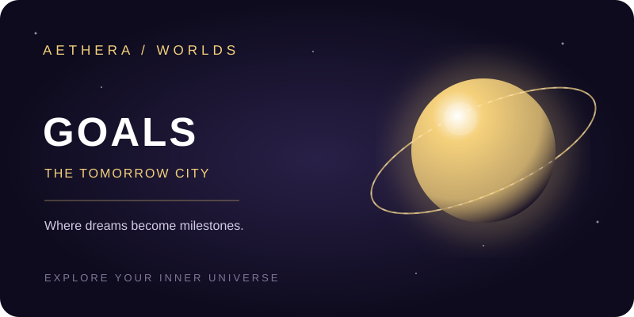

<div align="center">


<br/>

# A E T H E R A

### ✦ BEYOND IMAGINATION ✦

**YOUR MIND IS NOT A COLLECTION OF FOLDERS. IT IS AN ENTIRE UNIVERSE.**

<br/>

<a href="https://aethera-nine.vercel.app/">

</a>

<a href="https://github.com/oishipaul45-engineer/AETHERA">

</a>

<br/><br/>


</div>

<br/>

---

<div align="center">

### 01 / THE EXPERIENCE

# WHAT IF YOU COULD WALK THROUGH YOUR OWN IMAGINATION?

Your ideas shouldn't disappear into forgotten notes.

Your thoughts shouldn't be trapped inside ordinary interfaces.

Your goals shouldn't feel like another checklist.

**AETHERA transforms the way you experience your own mind.**

An immersive 3D personal universe where your ideas, thoughts, notes, projects, and goals become planets you can explore.

**Not just productivity. A different way of thinking.**

</div>

<br/>

---

<div align="center">

### 02 / THE CIVILIZATIONS

# FIVE WORLDS. ONE UNIVERSE.

*Each planet has its own purpose. Every world has a story.*

</div>

<table>
<tr>
<td width="50%">

</td>
<td width="50%">

</td>
</tr>
<tr>
<td>

### ✦ IDEAS

Grow possibilities through interactive stages of development.

</td>
<td>

### ✧ THOUGHTS

Combine thoughts and discover relationships between them.

</td>
</tr>
<tr>
<td>

</td>
<td>

</td>
</tr>
<tr>
<td>

### ◈ NOTES

Create a personal archive for your knowledge.

</td>
<td>

### ◇ PROJECTS

Build and assemble interactive creations.

</td>
</tr>
</table>

<div align="center">



### ✷ GOALS

Turn your ambitions into milestones and track their progress.

</div>

<br/>

---

<div align="center">

### 03 / IMMERSIVE EXPLORATION

# DON'T JUST VIEW YOUR WORLD. ENTER IT.

</div>

AETHERA includes an explorable 3D city experience.

Walk through its environment, change camera perspectives, and interact with activities tied to your personal universe.

| EXPERIENCE | WHAT IT MEANS |
|---|---|
| 🪐 **Living universe** | Navigate an interactive planetary system |
| ✦ **Connected worlds** | Build connections between your planets |
| 🏙️ **City exploration** | Explore a walkable 3D environment |
| 🎮 **Camera perspectives** | Switch between first-person and third-person views |
| 🧩 **Interactive activities** | Engage with category-specific experiences |
| 💾 **Local persistence** | Keep your information in browser storage |

### EXPLORATION CONTROLS

| KEY | ACTION |
|:---:|---|
| `W` `A` `S` `D` | Move |
| `SHIFT` | Run |
| `MOUSE` | Look around |
| `V` | Switch camera perspective |
| `E` | Interact / enter or exit |

<br/>

---

<div align="center">

### 04 / THE ENGINE

# BUILT FOR A DIFFERENT KIND OF WEB

<br/>


</div>

**Frontend:** React + TypeScript + Vite

**3D:** Three.js + React Three Fiber + Drei

**Styling:** CSS

**Persistence:** Browser localStorage

**Hosting:** Vercel

<br/>

---

<div align="center">

### 05 / LAUNCH SEQUENCE

# START EXPLORING

</div>

```bash
git clone https://github.com/oishipaul45-engineer/AETHERA.git
cd AETHERA/frontend
npm install
npm run dev
```

For a production build:

```bash
npm run build
```

<br/>

---

<div align="center">

### 06 / THE NEXT FRONTIER

# A UNIVERSE THAT KEEPS EXPANDING

</div>

- [x] Immersive 3D planetary universe
- [x] Interactive planets and connections
- [x] Walkable 3D city environment
- [x] First-person and third-person exploration
- [x] Five category-specific activities
- [x] Browser-local persistence
- [ ] Five fully distinct city environments
- [ ] Deeper physical 3D interactions
- [ ] Living characters and transportation
- [ ] Accounts and cloud synchronization
- [ ] AI-assisted idea connections

> **Current status:** AETHERA is an evolving prototype. The five categories currently share a foundational city environment. Activities are implemented through interactive interfaces, and user data is stored locally in the browser.

<br/>

---

<div align="center">

# ✦ YOUR UNIVERSE IS WAITING ✦

**Every thought is a world. Every connection is a constellation.**

<br/>

<a href="https://aethera-nine.vercel.app/">

</a>

<br/><br/>

Made with imagination by **[Oishi Paul](https://github.com/oishipaul45-engineer)**

### BEYOND IMAGINATION.

</div>
