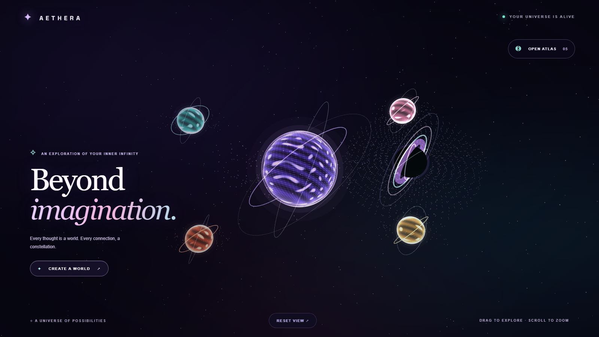
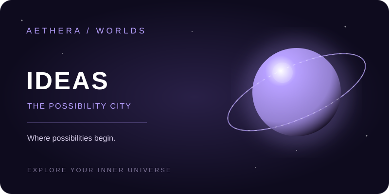
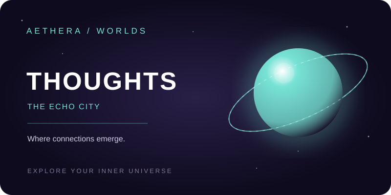
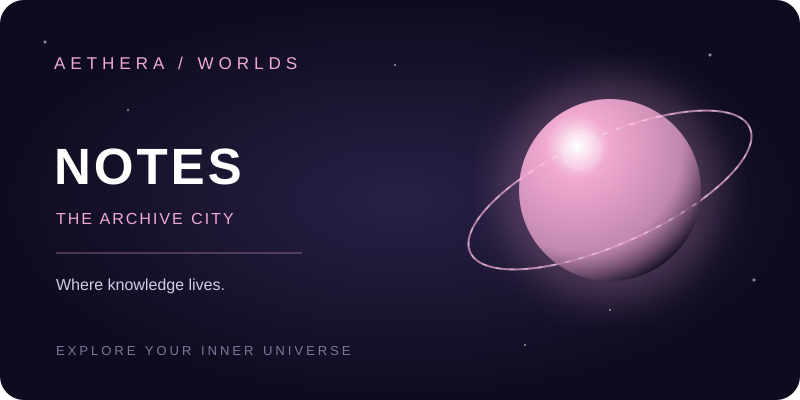
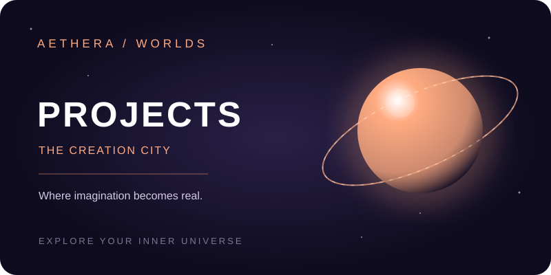
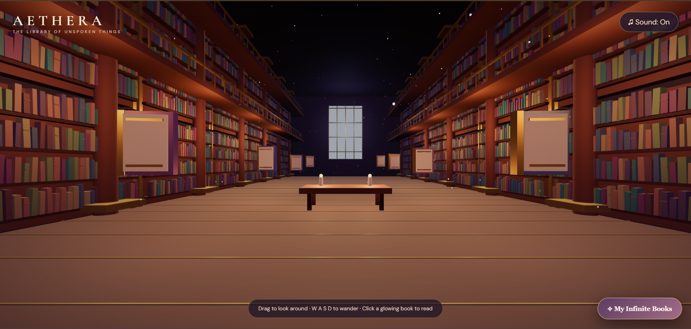
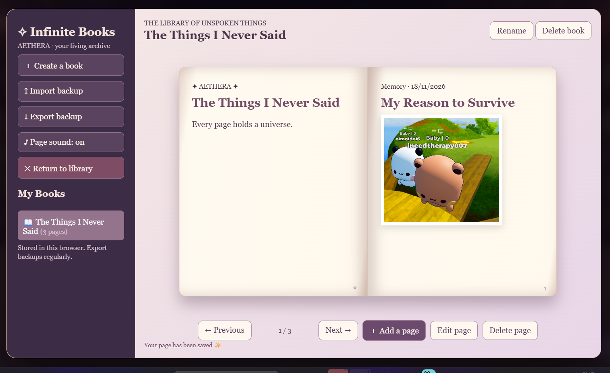

<div align="center">



# A E T H E R A

### ✦ BEYOND IMAGINATION ✦

**YOUR MIND IS NOT A COLLECTION OF FOLDERS. IT IS AN ENTIRE UNIVERSE.**

[](https://aethera-nine.vercel.app/)
[](https://github.com/oishipaul45-engineer/AETHERA)


</div>

---

<div align="center">

### 01 / THE EXPERIENCE

# WHAT IF YOU COULD WALK THROUGH YOUR OWN IMAGINATION?

Your ideas shouldn't disappear into forgotten notes.  
Your thoughts shouldn't be trapped inside ordinary interfaces.  
Your goals shouldn't feel like another checklist.

**AETHERA transforms the way you experience your own mind.**

An immersive personal universe where ideas, thoughts, notes, projects, and goals become worlds you can explore — now with a magical 3D library for the things you want to keep.

**Not just productivity. A different way of thinking.**

</div>

---

<div align="center">

### 02 / THE CIVILIZATIONS

# FIVE WORLDS. ONE UNIVERSE.

*Each planet has its own purpose. Every world has a story.*

</div>

| ✦ IDEAS | ✧ THOUGHTS |
|:---:|:---:|
|  |  |
| Grow possibilities through interactive stages of development. | Combine thoughts and discover relationships between them. |

| ◈ NOTES | ◇ PROJECTS |
|:---:|:---:|
|  |  |
| Create a personal archive for your knowledge. | Build and assemble interactive creations. |

<div align="center">


### ✷ GOALS

Turn your ambitions into milestones and track their progress.

</div>

---

<div align="center">

### 03 / THE LIBRARY OF UNSPOKEN THINGS

# SOME STORIES DESERVE THEIR OWN UNIVERSE.



*Actual screenshot from the working AETHERA 3D Library.*

</div>

Enter a warm, atmospheric library filled with towering bookshelves, floating lights, and books waiting to be explored. Move around the space using **W A S D**, drag to look around, and click a glowing book to read.

**The Grand Library is a separate browser-based experience** within the AETHERA project. Its source lives in [`AETHERA-3D-LIBRARY/`](./AETHERA-3D-LIBRARY/).

---

<div align="center">

### 04 / INFINITE BOOKS

# EVERY PAGE HOLDS A UNIVERSE.



*Actual screenshot of Infinite Books with a saved memory page.*

</div>

Create personal books, add pages, turn through memories, and return to them whenever you like. The working editor supports **12 page types**:

| | | |
|---|---|---|
| 📷 Memory | 💌 Letter | 🎙️ Voice |
| ⏳ Time Capsule | 🌙 Dream | 🗺️ Map |
| 🎨 Drawing | 📜 Timeline | 🔒 Secret |
| ✨ Interactive | 🎵 Music | 🎁 Keepsake |

**Included interactions:** book creation and renaming, adding/editing/deleting pages, animated page transitions, image and file attachments, drawing, recording controls, page sound, and import/export backups. Available fields vary by page type; some media features depend on browser permissions and supported formats.

**Privacy note:** Infinite Books data is stored locally in the browser. It does **not** automatically sync to GitHub or between devices. Export backups regularly; clearing browser data may remove your books. Secret-page passphrases are a local access gate, **not encryption**.

---

<div align="center">

### 05 / IMMERSIVE EXPLORATION

# DON'T JUST VIEW YOUR WORLD. ENTER IT.

</div>

AETHERA's planetary experience includes an explorable 3D city, perspective switching, and activities tied to your personal universe.

| EXPERIENCE | WHAT IT MEANS |
|---|---|
| 🪐 **Living universe** | Navigate an interactive planetary system |
| ✦ **Connected worlds** | Build connections between planets |
| 🏙️ **City exploration** | Explore a walkable 3D environment |
| 🎮 **Camera perspectives** | Switch between first-person and third-person views |
| 🧩 **Interactive activities** | Engage with category-specific experiences |
| 📚 **Grand Library** | Wander through a separate atmospheric 3D library |
| 📖 **Infinite Books** | Create and revisit personal multimedia books |
| 💾 **Local persistence** | Store data in your browser; export Infinite Books backups |

**Planetary city controls**

| KEY | ACTION |
|:---:|---|
| `W` `A` `S` `D` | Move |
| `SHIFT` | Run |
| `MOUSE` | Look around |
| `V` | Switch camera perspective |
| `E` | Interact / enter or exit |

**Grand Library controls:** `W` `A` `S` `D` to wander, drag to look around, click a glowing book to read, and select **My Infinite Books** to open your archive.

---

<div align="center">

### 06 / THE ENGINE

# BUILT FOR A DIFFERENT KIND OF WEB


</div>

**Planetary frontend:** React + TypeScript + Vite  
**Planetary 3D:** Three.js + React Three Fiber + Drei  
**Grand Library:** standalone HTML + JavaScript + Three.js + CSS  
**Persistence:** browser localStorage for the planetary experience; browser-local IndexedDB for Infinite Books  
**Hosting:** Vercel for the planetary frontend; the standalone library can be served locally

---

<div align="center">

### 07 / LAUNCH SEQUENCE

# START EXPLORING

</div>

**Planetary universe**

```bash
git clone https://github.com/oishipaul45-engineer/AETHERA.git
cd AETHERA/frontend
npm install
npm run dev
```

**Grand Library + Infinite Books** (from the repository root)

```bash
cd AETHERA-3D-LIBRARY
python -m http.server 8811 --bind 127.0.0.1
```

Then open `http://127.0.0.1:8811/index.html`.

**Planetary production build:** run `npm run build` inside `frontend/`.

> The live Vercel link above refers to the planetary frontend. Adding the library folder to GitHub does not automatically deploy it to that URL.

---

<div align="center">

### 08 / THE NEXT FRONTIER

# A UNIVERSE THAT KEEPS EXPANDING

</div>

- [x] Immersive 3D planetary universe
- [x] Interactive planets and connections
- [x] Walkable 3D city environment
- [x] First-person and third-person exploration
- [x] Five category-specific activities
- [x] Atmospheric, explorable Grand Library
- [x] Infinite Books editor with 12 page types
- [x] Browser-local book storage and backup import/export
- [ ] Five fully distinct city environments
- [ ] Deeper physical 3D interactions
- [ ] Living characters and transportation
- [ ] Accounts and cloud synchronization
- [ ] AI-assisted idea connections

> **Current status:** AETHERA is an evolving prototype. The five planetary categories currently share a foundational city environment. The Grand Library and Infinite Books are separate working experiences. User-created content is browser-local rather than cloud-synced.

---

<div align="center">

# ✦ YOUR UNIVERSE IS WAITING ✦

**Every thought is a world. Every connection is a constellation.**

[](https://aethera-nine.vercel.app/)

Made with imagination by **[Oishi Paul](https://github.com/oishipaul45-engineer)**

### BEYOND IMAGINATION.

</div>
